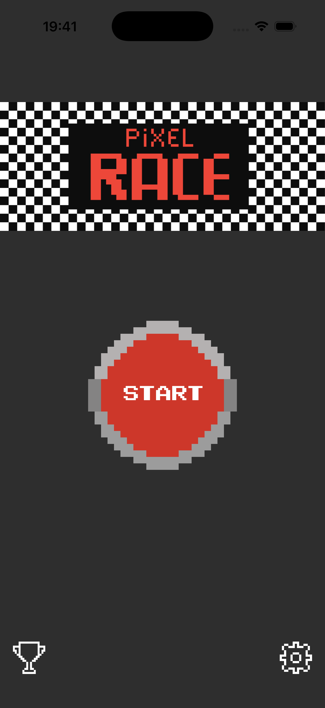
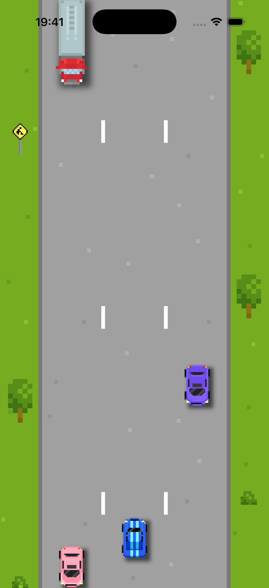
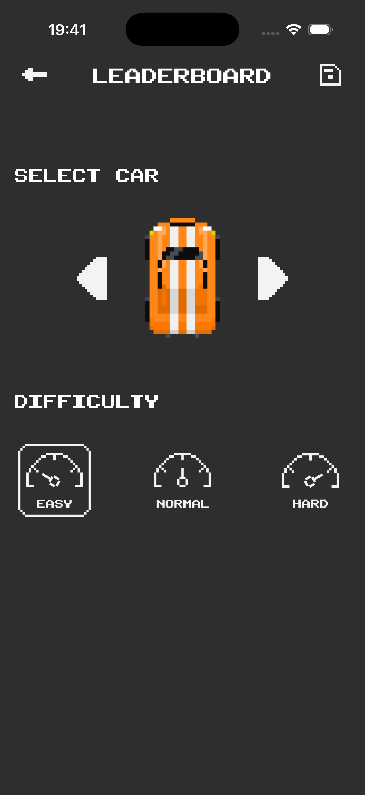
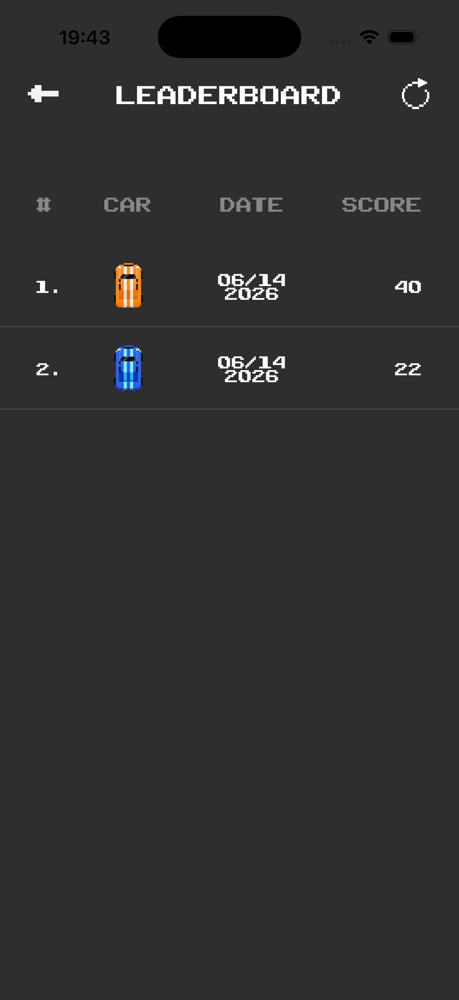

# 🏎️ PixelRace 🏁

A pixel-art arcade racing game for iOS, built with UIKit's default tools (no SpriteKit / SceneKit).

## About

PixelRace is a top-down endless racer with a retro pixel aesthetic. You drive between lanes, dodge traffic and roadside obstacles, and try to push your high score as the speed ramps up. The entire game world — road, scenery, cars, and effects — is rendered using plain `UIView` animations and Core Graphics.

## Features

- **Three player cars** to choose from
- **Three difficulty levels** — Easy / Normal / Hard, each with its own speedometer skin
- **Dynamic traffic** — civil cars and trucks spawn in random lanes
- **Roadside scenery** — bushes, trees, and road signs scroll past the side of the road
- **Animated road and side effects** for a sense of speed
- **Persistent leaderboard** — results stored locally (car, score, date)
- **Localization** — English and Spanish
- **Custom pixel font** (`PublicPixel.ttf`) for that arcade feel
- **Firebase Analytics & Crashlytics** integration

## Tech stack

- Swift / UIKit
- Pure `UIView` + Core Animation (no game engine)
- CocoaPods for dependencies
- Firebase Analytics, Firebase Crashlytics

## Project structure

```
PixelRace/
├── GameViewController/      # Main gameplay screen
├── SettingsViewController/  # Car & difficulty selection
├── LeaderboardViewController/  # Saved results
├── Managers/                # Game, Spawner, Collision, Results, Analytics
├── Models/                  # Settings, Result, NavigationBarItem
├── Enums/                   # Lane, Side, Move, Difficulty, TrafficObject, SideObject
├── Views/                   # Custom UI components
├── Resources/               # Fonts and localized strings
└── Assets.xcassets/         # Pixel-art sprites
```

## Build & run

1. Install dependencies:
   ```bash
   pod install
   ```
2. Open `PixelRace.xcworkspace` in Xcode.
3. Build and run on an iOS simulator or device.

## Screenshots

| Main menu | Gameplay |
| :---: | :---: |
|  |  |

| Settings | Leaderboard |
| :---: | :---: |
|  |  |
